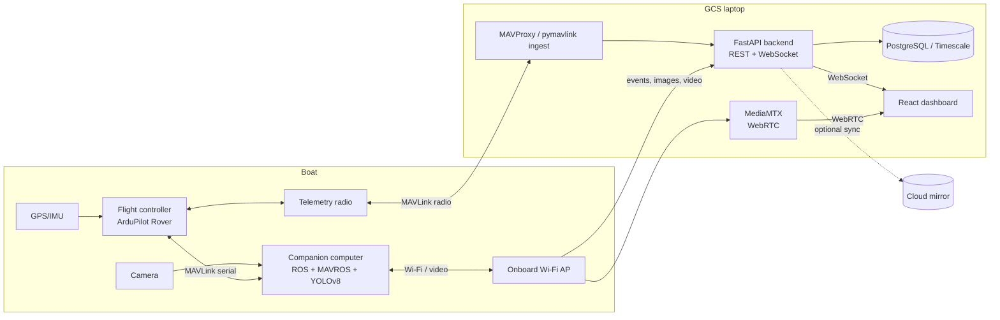

# System architecture (draft v0.1)

Three zones: **Boat**, **GCS laptop** (shore, runs mission and local dashboard), **Cloud mirror** (optional, for remote viewing).

## Data flows
1. **Telemetry** (position, heading, SOG/COG, battery): FC -> radio -> MAVProxy/pymavlink -> `POST /api/v1/telemetry` -> DB + WebSocket.
2. **Mission events** (buoy pass, penalty, capture, docking): ROS mission node -> Wi-Fi -> `POST /api/v1/events`.
3. **Images** (surface/underwater capture): ROS -> Wi-Fi -> `POST /api/v1/images` (multipart).
4. **Video**: camera -> Jetson -> MediaMTX -> WebRTC -> dashboard.
5. **Store-and-forward**: ROS keeps an outbox queue; resends events and images after link loss.
6. **Failsafe**: link loss -> boat stops and holds position (mode HOLD), per the guidebook. Backend flags `link_lost` on the dashboard.

## Ownership
- Boat/ROS side: Arya. Backend + contract: Jojo. Dashboard: Bertrant.
